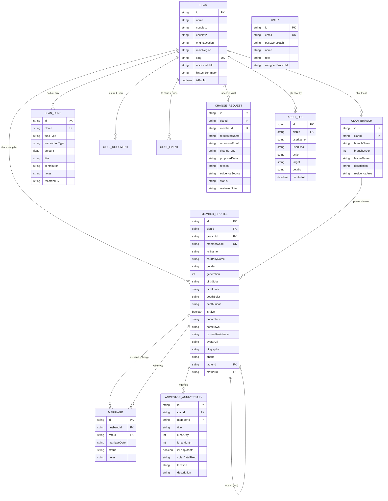

# Mô Hình Dữ Liệu Quan Hệ (ERD) — VietFamilyTree

## 1. Biểu Đồ Quan Hệ Thực Thể (Entity Relationship Diagram)

## 2. Các Ràng Buộc Quan Hệ Đặc Thù
- **Tự tham chiếu huyết thống (Self-referential relations)**: `MemberProfile.fatherId` và `MemberProfile.motherId` trỏ về chính `MemberProfile.id`. Khi một phụ huynh bị xóa, hệ thống dùng `onDelete: SetNull` để tránh làm mất bản ghi của con cái.
- **Ràng buộc hôn phối (`Marriage`)**: Tách riêng hai quan hệ `husbandId` và `wifeId` trỏ về `MemberProfile`, cho phép một thành viên có thể có nhiều mối quan hệ hôn nhân hợp lệ trong lịch sử mà không làm sai lệch huyết thống cha mẹ.
- **Ràng buộc tính toàn vẹn**: Khi xóa một thành viên, API kiểm tra `childCount` phụ thuộc. Nếu có con cái, hệ thống từ chối xóa và yêu cầu điều chuyển cha mẹ trước.
